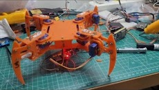

# ESP32 Quadruped Walker

A 2-DOF-per-leg quadruped robot driven by an ESP32 and 8 micro servos (SG90 / MG90S). It stands up, then walks forward with a 4-phase diagonal crawl gait.

## Hardware

- ESP32 dev board
- 8 × SG90 or MG90S micro servos (one hip + one knee per leg)
- 3D-printed body and legs
- 5–6 V supply for the servos, able to deliver a few amps (don't power 8 servos from the ESP32's 3.3 V/5 V pin). Tie the servo ground to the ESP32 ground.

## Wiring

| Leg | Hip pin | Knee pin |
|---|---|---|
| Front left (FL) | GPIO 13 | GPIO 12 |
| Front right (FR) | GPIO 14 | GPIO 27 |
| Rear left (RL) | GPIO 26 | GPIO 25 |
| Rear right (RR) | GPIO 33 | GPIO 32 |

## Software

1. Install the ESP32 board package in the Arduino IDE.
2. Install the **ESP32Servo** library (Library Manager).
3. Open `quadruped_walker/quadruped_walker.ino`, select your ESP32 board and port, and upload.

## Tuning

These constants are at the top of the sketch:

| Constant | Default | What it does |
|---|---|---|
| `HIP_CENTER` | 90 | Neutral hip angle |
| `KNEE_STAND` | 90 | Knee angle when standing |
| `HIP_SWING` | 25 | Forward/back swing amplitude (°) |
| `KNEE_LIFT` | 35 | How high a leg lifts during swing (°) |
| `STEP_DELAY` | 120 | Delay between gait steps (ms); lower = faster |

Before walking, set every servo to 90° and mount the horns so the legs sit in a neutral stance. If a leg moves the wrong way, flip the sign of its offset in `walkForward()`.

## Gait

1. Lift FL + RR, swing them forward, lower.
2. Return FL + RR hips to center while FR + RL push back (body shifts forward).
3. Lift FR + RL, swing them forward, lower.
4. Return FR + RL hips to center while FL + RR push back.
